# Procedury ręczne GUI — etap M1 (M1.4c3)

Wymagania interfejsu weryfikowane ręcznie (`verify: manual`). Każde ma też test E2E (`web/e2e/*.spec.ts`), który sprawdza zachowanie automatycznie. Ta procedura dokumentuje, jak sprawdzić wymaganie samodzielnie i co widać na ekranie.

**Środowisko zrzutów** (2026-11-02): Windows 11 Home, Microsoft Edge 156 (Playwright 1.48.2, kanał `msedge`), okno 1280×800 px, skala 1 (HiDPI: skala 2), host `burncraft-cli serve` (kompilacja debug), motyw ciemny, język polski, jednostki mm. Okno desktopowe: `burncraft` (Tauri 2, WebView2).

**Odtworzenie zrzutów** (z katalogu `web/`, po `cargo build -p bc-cli` i `npm run build`):

```bash
BC_SCREENSHOTS=1 PW_CHANNEL=msedge npx playwright test procedures
```

Spec `web/e2e/procedures.spec.ts` rysuje przykładowy projekt (prostokąt z zaokrąglonymi narożnikami na C00, elipsa C01, sześciokąt C02, gwiazda C03, krzywa Béziera C04), wykonuje kroki opisane niżej i zapisuje zrzuty w `docs/procedures/img/m1/`. Każdy zrzut obejrzano i porównano z wymaganiem. Uwagi z przeglądu są przy wymaganiu.

Ręcznie: uruchom `burncraft` (okno) albo `burncraft-cli serve` i otwórz `http://127.0.0.1:7984/`, a następnie wykonaj kroki z sekcji.

## REQ-01-021 — GUI: Tauri 2 + TypeScript

Procedura: uruchom `burncraft --open sample.bcraft` (Windows). Okno Tauri 2 ładuje frontend TypeScript z hosta w tym samym procesie. Test `req_01_017_021_042_control_port_starts_window_connected_to_channel` (`app/tests/window.rs`) sprawdza, że okno łączy się z kanałem jako okno i zwraca agentowi zrzut kanwy.

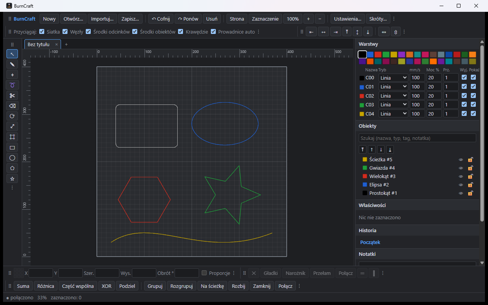

Wynik: **zgodne**. Natywne okno Windows (WebView2) pokazuje ten sam interfejs co przeglądarka. Projekt z pliku `.bcraft` został otwarty, a pasek stanu pokazuje „połączono”.

## REQ-03-001, REQ-03-002, REQ-03-003, REQ-03-017 — siatka, linijki, obszar maszyny, ciemne tło

Procedura: otwórz program z przykładowym projektem; zaznacz prostokąt.

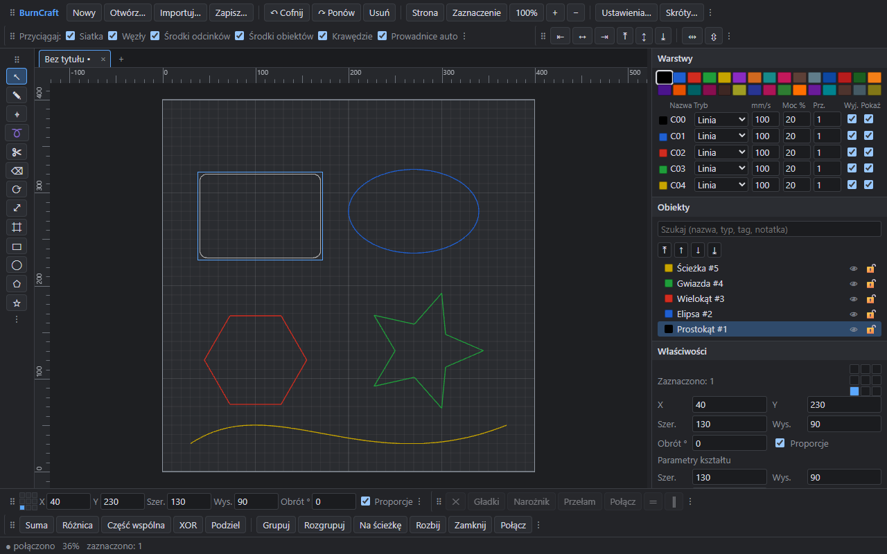

Wynik: **zgodne**.
- REQ-03-001: siatka ma oczka drobne i główne, a gęstość zmienia się z powiększeniem (1-2-5).
- REQ-03-002: linijki u góry i z lewej mają podziałkę w mm zgodną z powiększeniem i znacznik położenia kursora.
- REQ-03-003: obszar maszyny 400×400 mm jest jaśniejszym prostokątem z obrysem.
- REQ-03-017: tło obszaru roboczego jest ciemne.

Uwaga z przeglądu (poprawione w M1.4c3): czarna warstwa C00 była na ciemnym tle prawie niewidoczna. Bardzo ciemne kolory warstw są teraz na kanwie rozjaśniane, a w motywie jasnym bardzo jasne przyciemniane. Kolor warstwy w dokumencie się nie zmienia. Sprawdza to test `req_03_017_dark_layer_colors_stay_visible_on_dark_background`.

## REQ-03-006 … REQ-03-010 — przyciąganie

Procedura: narzędzie Linia, prostokąt 80×50 mm, kursor 4 px od celu. Zielony kwadrat oznacza punkt przyciągnięcia, a pasek stanu podaje jego rodzaj. Przełączniki są na pasku trybów.

| Wymaganie | Cel | Zrzut |
|---|---|---|
| REQ-03-006 siatka | linia zaczęta i skończona obok węzłów siatki leży dokładnie na nich; pasek stanu: „przyciąganie: siatka” | 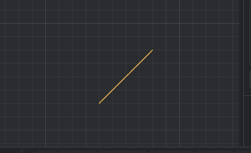 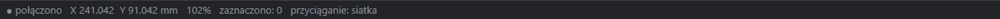 |
| REQ-03-007 obiekty (krawędź) | punkt na górnej krawędzi | 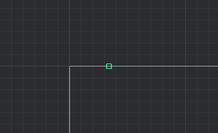 |
| REQ-03-008 węzły | lewy dolny narożnik | 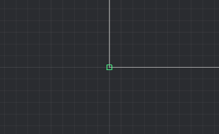 |
| REQ-03-009 środki obiektów | środek prostokąta | 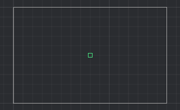 |
| REQ-03-010 punkty środkowe linii | środek dolnego boku | 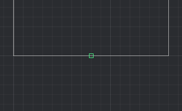 |

Wynik: **zgodne**. Znacznik siatki celowo nie jest rysowany, bo przy każdym ruchu byłby widoczny. Siatkę potwierdzają końce linii i pasek stanu.

## REQ-03-011 — prowadnice automatyczne

Procedura: narzędzie Linia; kursor daleko nad prostokątem, w linii z jego lewą krawędzią.

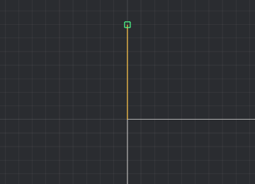

Wynik: **zgodne**. Pomarańczowa prowadnica łączy kursor z węzłem prostokąta, a punkt przyciąga się do jego osi X.

## REQ-03-012 — prowadnice ręczne

Procedura: przeciągnij z górnej linijki na kanwę i puść na wysokości 80 mm.

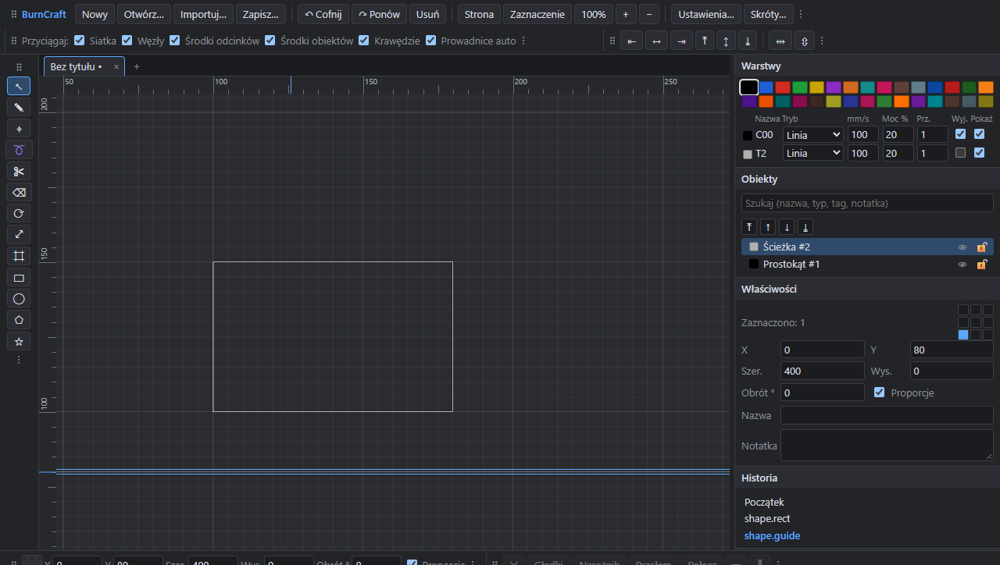

Wynik: **zgodne**. Powstaje pozioma prowadnica `shape.guide` (obiekt pomocniczy na warstwie T2). W panelu Warstwy warstwa T2 ma wyłączone wyjście, więc prowadnica nie trafia do zadania lasera.

## REQ-03-013, REQ-03-014, REQ-03-015 — zoom do zaznaczenia, strony i 100%

Procedura: zaznacz gwiazdę → „Zaznaczenie”; potem „Strona”; potem „100%”. Kalibracja: Ustawienia → Kalibracja ekranu. Zmierz niebieski pasek linijką i wpisz wynik.

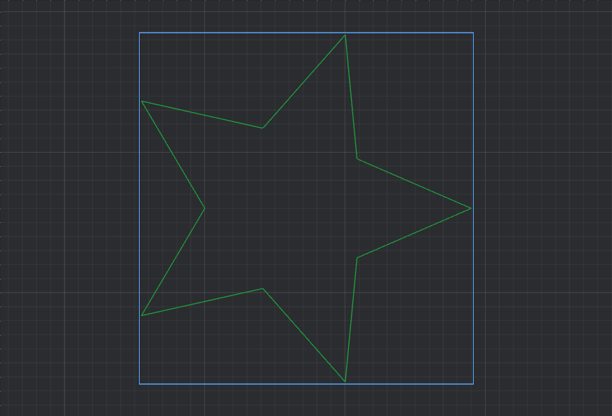

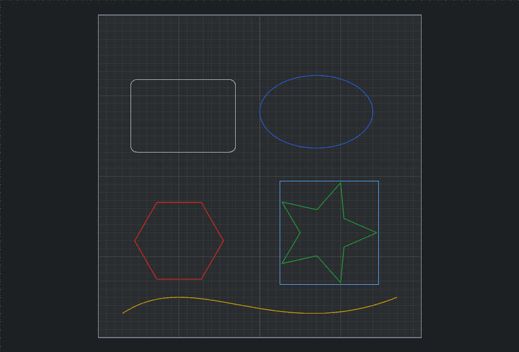

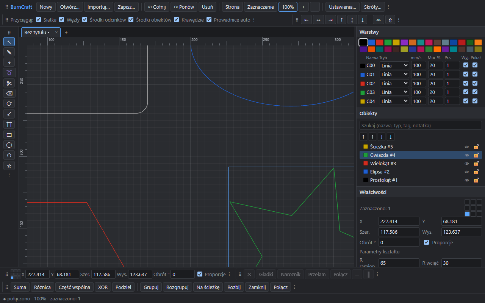

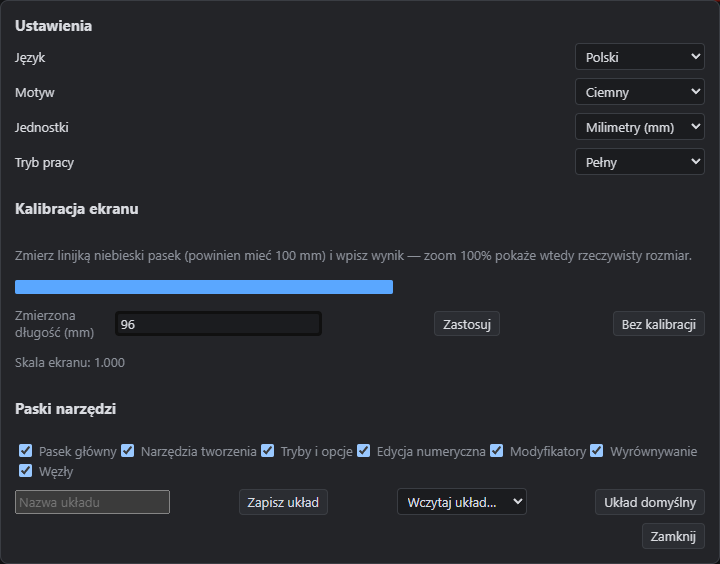

Wynik: **zgodne**.
- REQ-03-013: gwiazda wypełnia kanwę z marginesem.
- REQ-03-014: cały obszar 400×400 mm jest widoczny.
- REQ-03-015: pasek stanu pokazuje 100%. Bez kalibracji 1 mm to 96/25,4 px CSS. Wpisanie długości paska zmierzonej linijką ustawia `ui.screen_scale` (np. 96 mm → skala 1,042), a 100% oznacza wtedy rzeczywisty rozmiar na tym monitorze. Test `req_03_015_screen_calibration_makes_100_percent_physical` sprawdza przeliczenie i zapis kalibracji.
  Pomiar fizyczny (2026-11-02, zleceniodawca, okno `burncraft.exe` na Windows): pasek wzorcowy bez kalibracji miał linijką **68 mm**, czyli monitor nie ma deklarowanych 96 dpi. Po wpisaniu 68 mm (skala ekranu 100/68 ≈ 1,471) ten sam pasek miał **100 mm**. Zoom 100% pokazuje więc po kalibracji rzeczywisty rozmiar, a pomiar potwierdza, że kalibracja jest potrzebna.

## REQ-03-016 — motyw ciemny / jasny / systemowy

Procedura: Ustawienia → Motyw → Jasny (oraz Systemowy: zgodnie z ustawieniem Windows).

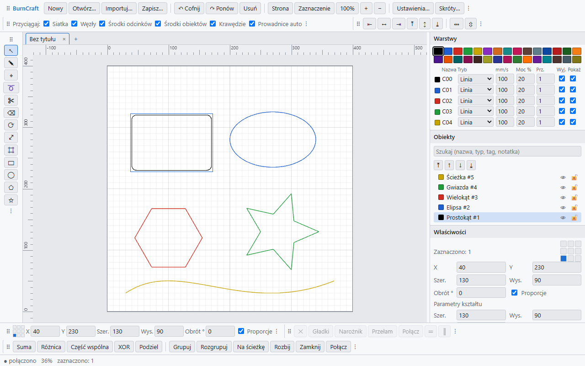

Wynik: **zgodne**. Panele, paski, linijki i kanwa przełączają się razem. Czarna warstwa C00 na białym tle zostaje czarna. Test `req_03_016_light_dark_and_system_theme` sprawdza też tryb systemowy.

## REQ-03-018 — skalowanie High-DPI / 4K

Procedura: ekran ze skalą 200% (tu: przeglądarka z `deviceScaleFactor: 2`).

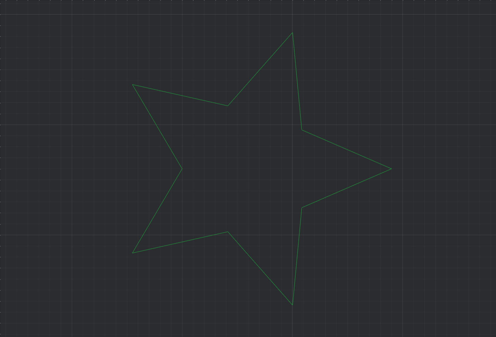

Wynik: **zgodne**. Kanwa ma 1725 px urządzenia na 862 px CSS (devicePixelRatio = 2), a linie i siatka są ostre, bez rozmycia. Trafianie myszą przy skali 2 sprawdza test `req_03_018_canvas_and_rulers_render_at_device_resolution`.

## REQ-03-019 — gesty dotykowe i trackpada

Procedura: na ekranie dotykowym rozsuń dwa palce na kanwie i przesuń je razem. Na trackpadzie: gest „pinch”.

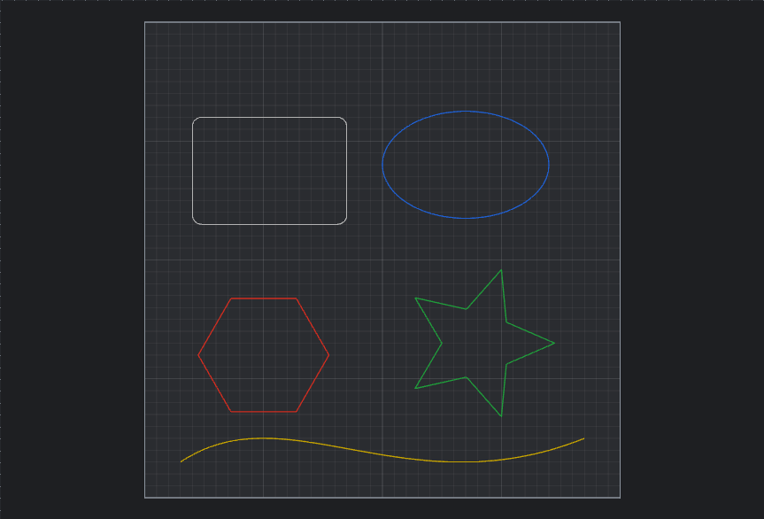

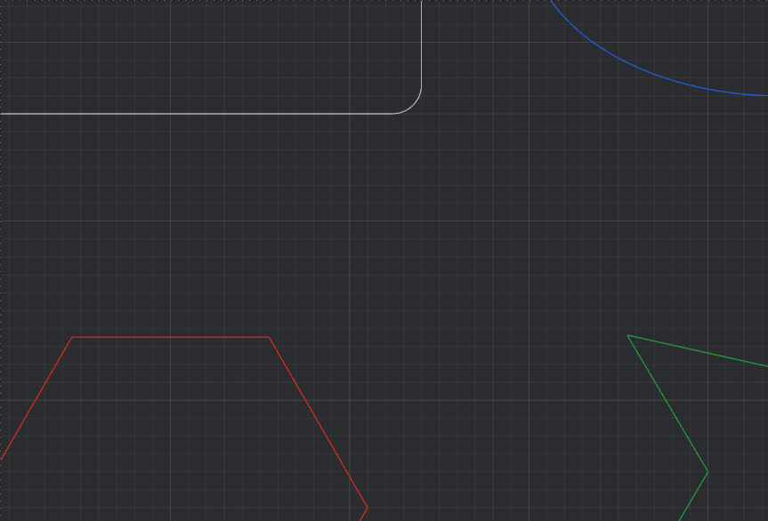

Wynik: **zgodne**. Rozsunięcie powiększa widok wokół środka między palcami, a przesunięcie przesuwa widok. Gest niczego nie zaznacza i nie przesuwa. Jeden palec działa jak lewy przycisk myszy. Pinch trackpada przychodzi jako kółko z Ctrl. Zrzuty zrobiono zdarzeniami dotyku `PointerEvent` (`pointerType: "touch"`), tymi samymi, które wysyła ekran dotykowy.

## REQ-03-020 … REQ-03-024, REQ-03-029, REQ-03-030 — paski narzędzi

| Wymaganie | Pasek |
|---|---|
| REQ-03-020 główny (plik, cofnij/ponów, usuń, zoom, ustawienia, skróty) | 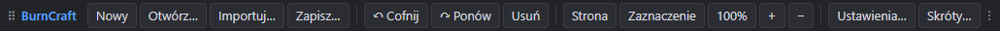 |
| REQ-03-021 tworzenia (pionowy, dok lewy) | 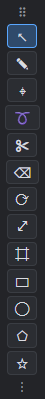 |
| REQ-03-022 trybów (opcje narzędzia, przełączniki przyciągania) |  |
| REQ-03-023 modyfikatorów (operacje logiczne, grupowanie, konwersja, rozbij, zamknij, połącz) | 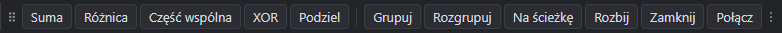 |
| REQ-03-024 edycji numerycznej X/Y/szer./wys./obrót | 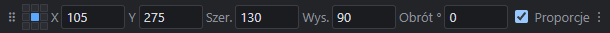 |
| REQ-03-029 wyrównywania (krawędzie, środki, rozkład) | 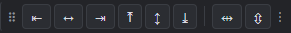 |
| REQ-03-030 węzłów (usuń, gładki, narożnik, przełam, połącz, wyrównaj) | 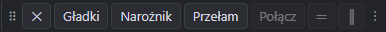 |

Wynik: **zgodne**. Każdy przycisk wywołuje polecenie z rejestru i ma podpowiedź. Pasek węzłów jest aktywny przy zaznaczonym węźle narzędzia Węzły.

## REQ-03-025, REQ-03-026 — punkt odniesienia 3×3 i blokada proporcji

Procedura: zaznacz prostokąt; na pasku numerycznym kliknij środkowy punkt siatki 3×3; zaznacz lub odznacz „Proporcje”.


Wynik: **zgodne**. X/Y pokazują wybrany punkt ramki. Zmiana szerokości przy włączonych proporcjach skaluje też wysokość. Ten sam stan mają panel Właściwości i pasek numeryczny.

## REQ-03-027, REQ-03-028 — mm/in i przeliczanie w polach

Procedura: Ustawienia → Jednostki → Cale; na pasku numerycznym wpisz w szerokość `127mm` i Enter.

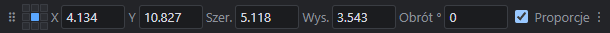

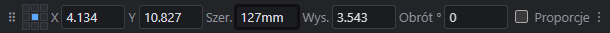

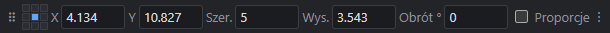

Wynik: **zgodne**. Pola pokazują cale, a wartość z jednostką (`mm`, `cm`, `in`, `"`) jest przeliczana na jednostkę bieżącą.

## REQ-03-031 — paski konfigurowalne, dokowalne, z zapisem układów

Procedura: menu paska Wyrównywanie (⋮) → Dokuj z lewej; przeciągnij uchwyt paska Modyfikatory do prawego doku; Ustawienia → wpisz nazwę układu → Zapisz układ.

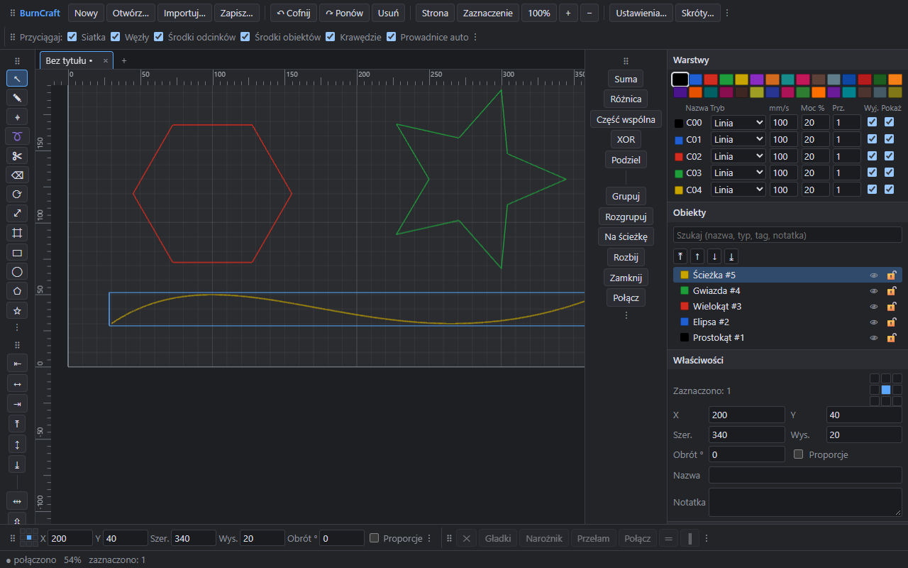

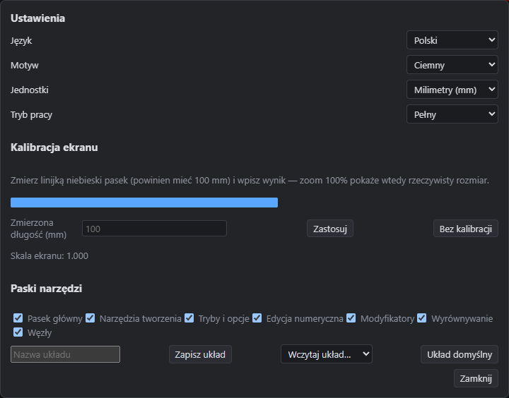

Wynik: **zgodne**. Wyrównywanie stoi pionowo w lewym doku, a Modyfikatory w prawym. Układ zostaje po ponownym uruchomieniu (`ui.toolbars`). Nazwany układ „Cięcie” jest na liście „Wczytaj układ…”, a każdy pasek można ukryć.

## REQ-03-032 — okno Warstwy/Cięcia

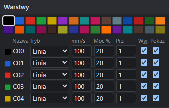

Wynik: **zgodne**. Panel ma paletę 30 kolorów i tabelę używanych warstw z kolumnami tryb, prędkość, moc, przejścia, wyjście i pokaż. Zmiana pola zmienia warstwę w dokumencie (`layer.set`).

## REQ-03-047 — okno Właściwości kształtu

Procedura: zaznacz sześciokąt; w „Parametry kształtu” zmień liczbę boków.

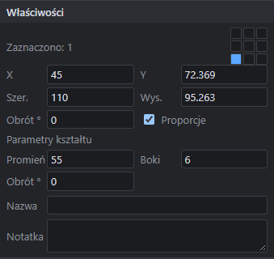

Wynik: **zgodne**. Panel pokazuje położenie, rozmiar, obrót, nazwę, notatkę i parametry kształtu parametrycznego: promień, liczbę boków i obrót wielokąta. Prostokąt ma szerokość, wysokość i zaokrąglenie, elipsa półosie, a gwiazda promienie i liczbę ramion. Zmiana działa przez `shape.set_params` bez konwersji na ścieżkę.

## REQ-03-048 — okno Historia cofania z podglądem stanów i skokiem

Procedura: najedź na krok „shape.ellipse” w panelu Historia; kliknij krok, aby do niego wrócić.

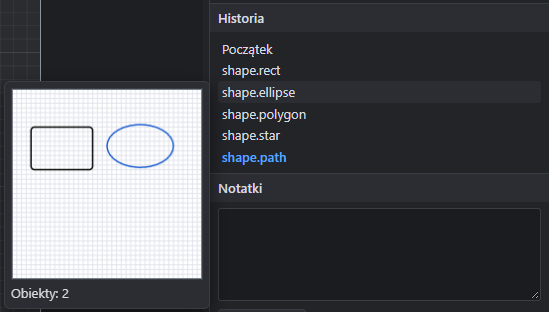

Wynik: **zgodne**. Miniatura pokazuje dokument po tym kroku (2 obiekty) i niczego nie cofa. Kliknięcie przechodzi do stanu, a kroki do ponowienia są widoczne kursywą.

## REQ-03-049 — okno Notatki z obrazami

Procedura: wpisz notatkę; „Dodaj obraz” (albo wklej obraz ze schowka, albo upuść plik na panel).

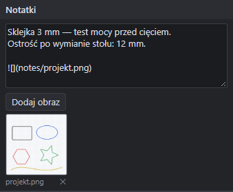

Wynik: **zgodne**. Obraz jest zapisywany w `.bcraft` (`notes/projekt.png`), a tekst dostaje odwołanie ``. ✕ usuwa obraz razem z odwołaniem; usunięcie można cofnąć.

## REQ-03-051 — tryb początkującego i tryb pełny

Procedura: Ustawienia → Tryb pracy → Początkujący.

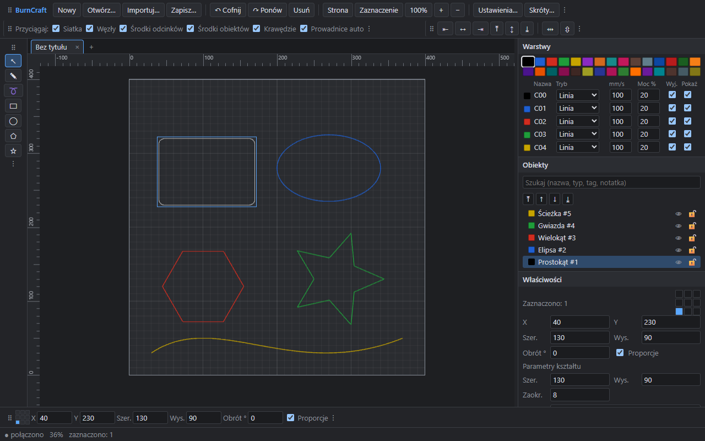

Wynik: **zgodne**. W porównaniu z trybem pełnym znikają narzędzia zaawansowane, paski wyrównywania, modyfikatorów i węzłów oraz kolumna przejść w tabeli warstw.

## REQ-03-055 — kursor zależny od narzędzia

Procedura: wybieraj kolejno narzędzia z paska tworzenia i obserwuj kursor nad kanwą. Zrzut ekranu nie obejmuje kursora myszy, dlatego poniżej są obrazy kursorów, które program ustawia kanwie (`canvas.style.cursor`).

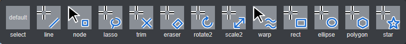

Wynik: **zgodne**. Każde narzędzie ma inny kursor: krzyżyk albo strzałkę z symbolem narzędzia. Zaznaczanie używa strzałki systemowej. Gdy system nie wyświetli kursora SVG, używany jest kursor systemowy (`crosshair` albo `default`). Uwaga z przeglądu (poprawione w M1.4c3): wcześniej zaznaczanie i węzły miały ten sam kursor, a wszystkie narzędzia rysowania wspólny krzyżyk.

## REQ-03-056 — menu kontekstowe w edycji węzłów

Procedura: narzędzie Węzły; prawy klik na węźle krzywej.

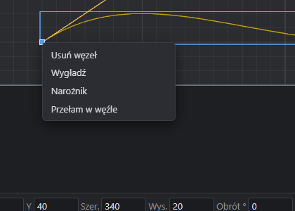

Wynik: **zgodne**. Menu węzła końcowego zawiera: usuń węzeł, wygładź, narożnik, przełam w węźle. Prawy klik na segmencie daje: dodaj węzeł, linia/krzywa, nożyczki. Przy kilku zaznaczonych węzłach dochodzą połącz i wyrównaj (test `req_03_056_and_req_04_025_to_029_context_menu_actions`).

## REQ-03-057 — podpowiedzi kontekstowe do każdego pola

Procedura: najedź na dowolny przycisk, pole lub listę, także w oknach Ustawienia i Skróty.

Wynik: **zgodne**. Każdy element sterujący ma podpowiedź (`title`) i etykietę dostępności. Test `req_03_057_every_field_has_contextual_hint` przechodzi przez cały interfejs i oba okna dialogowe i zgłasza każdy element bez podpowiedzi. Podpowiedzi systemowe nie pojawiają się na zrzutach ekranu.

## REQ-03-061 — lokalizacja: angielski

Procedura: Ustawienia → Język → English.

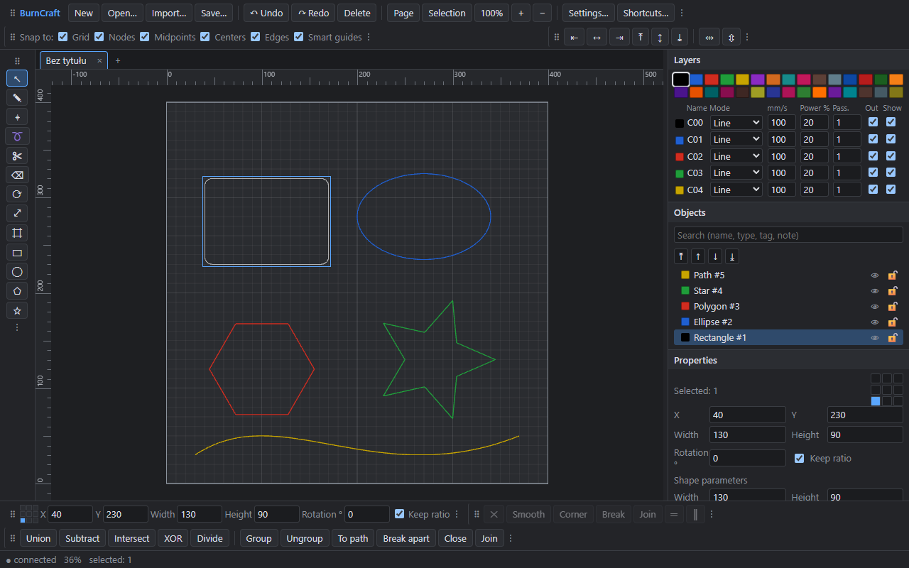

Wynik: **zgodne**. Paski, panele, pasek stanu i nazwy obiektów są po angielsku. Nazwa dokumentu („Bez tytułu”) jest daną dokumentu, więc się nie tłumaczy. Kompletność tłumaczeń sprawdza `tools/i18n/test_ftl.py`.
