# Procedury ręczne GUI — etap M2 (M2.5)

Wymagania okien maszyny weryfikowane ręcznie (`verify: manual`). Każde ma też test E2E (`web/e2e/machine.spec.ts`), który na emulatorze GRBL („Symulator”) sprawdza zachowanie automatycznie. Ta procedura opisuje, jak sprawdzić wymaganie samodzielnie i co widać na ekranie. Wymagania `auto` z M2.5 (podgląd, kerf, wyrównanie do lasera) mają testy w `crates/bc-commands/tests/m25_commands.rs` i `web/e2e/machine.spec.ts`. Ich zrzuty są tu jako ilustracja.

**Środowisko zrzutów** (2026-11-05): Windows 11 Home, Microsoft Edge (Playwright 1.64.1, kanał `msedge`), okno 1280×800 px, skala 1, host `burncraft-cli serve` (kompilacja debug), motyw ciemny, język polski, jednostki mm. Urządzenie: „Symulator” (wbudowany emulator GRBL 1.1 w czasie rzeczywistym).

**Odtworzenie zrzutów** (z katalogu `web/`, po `cargo build -p bc-cli` i `npm run build`):

```bash
BC_SCREENSHOTS=1 PW_CHANNEL=msedge npx playwright test procedures-m2
```

Spec `web/e2e/procedures-m2.spec.ts` rysuje przykładowy projekt i zapisuje zrzuty w `docs/procedures/img/m2/`. Projekt to tablica 120×80 mm z zaokrąglonymi narożnikami i okrągłym otworem: jeden kontur na C00, kerf 0,4 mm, 2 przejścia, 25 mm/s. Do tego gwiazda na C01 (1 przejście). Wszystkie zrzuty obejrzano i porównano z wymaganiami. Uwagi z przeglądu są przy wymaganiach.

Ręcznie: uruchom `burncraft` (okno) albo `burncraft-cli serve` i otwórz `http://127.0.0.1:7984/`. Okna maszyny są w panelu bocznym pod Notatkami (Laser, Przesuń, Konsola, Makra). Podgląd otwiera przycisk „Podgląd” na pasku głównym albo w oknie Laser.

## REQ-03-033 — okno Laser: start/pauza/stop, ramka, punkt startowy, pozycja zadania

Procedura: w oknie Laser wybierz „Symulator” i naciśnij „Połącz”. Naciśnij „Start”, potem „Pauza”, „Wznów” i na końcu poczekaj na koniec zadania. „Ramka” obrysowuje zadanie bez wiązki. „Punkt startowy” ustawia start od współrzędnych bezwzględnych, bieżącej pozycji albo zera użytkownika. Siatka 3×3 „Pozycja zadania” wybiera punkt zadania (9-punktowy origin). „Ustaw zero”, „Idź do zera” i „Bazuj” działają na urządzeniu. Każdy przycisk wywołuje polecenie rejestru (`job.start`, `job.pause`, `job.resume`, `job.stop`, `device.frame`, `job.start_settings`, `device.set_origin`, `device.go_origin`, `device.home`).

| Stan | Zrzut |
|---|---|
| zadanie w toku: stan „praca”, pozycja głowicy, 50 %, „przejście 2/2”, czas | 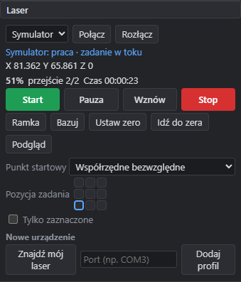 |
| pauza: „wstrzymany · zadanie wstrzymane” | 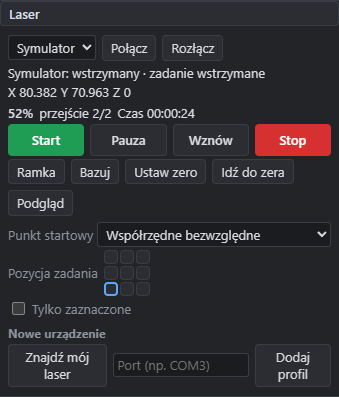 |
| punkt startowy „Zero użytkownika”, pozycja zadania „środek” | 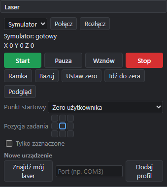 |

Ramka w trakcie wykonywania: głowica (czerwony krzyż) jedzie po obrysie zadania. Zadanie zakończone pokazuje „Zakończono w 00:00:53”.

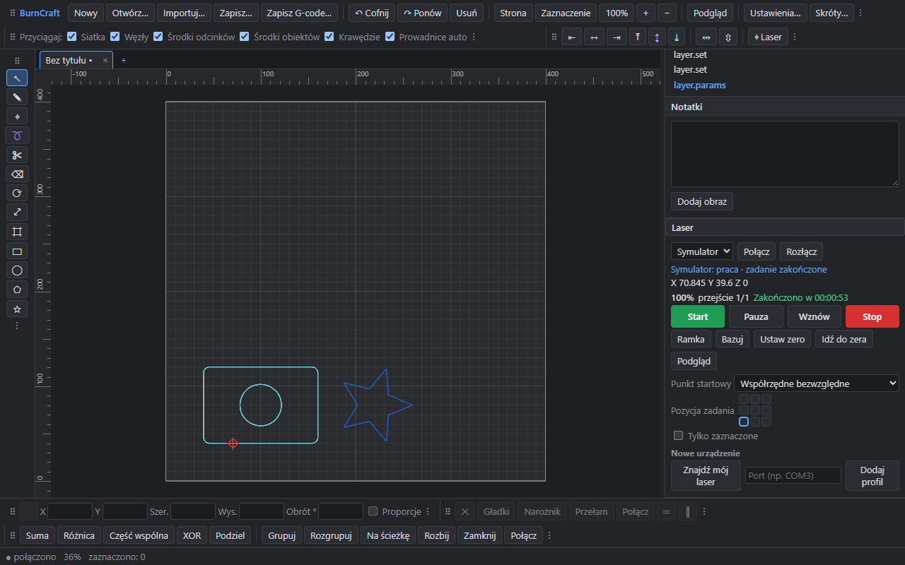

Wynik: **zgodne**. Uwagi z przeglądu (poprawione przed zatwierdzeniem):
- W pierwszej wersji zrzut pauzy pokazywał stan „praca”, bo okno pokazywało tylko stan maszyny. Okno pokazuje teraz także stan zadania („zadanie wstrzymane”).
- Lista „Punkt startowy” była ucięta przez ogólną regułę CSS dla list. Teraz zajmuje całą szerokość wiersza.

## REQ-03-052 — przyciski Start zielony / Stop czerwony z konfigurowalnymi kolorami

Procedura: obejrzyj okno Laser: Start jest zielony (`#1f9d55`), a Stop czerwony (`#d63031`). W „Ustawienia…” zmień „Kolor przycisku Start” i „Kolor przycisku Stop”. Kolory zapisują się w preferencjach (`ui.start_color`, `ui.stop_color`). „Domyślne kolory” je przywraca.

| Ustawienia | Okno Laser po zmianie |
|---|---|
| 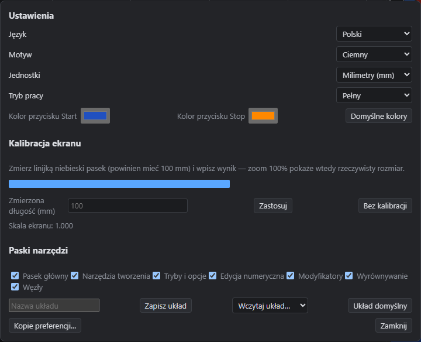 | 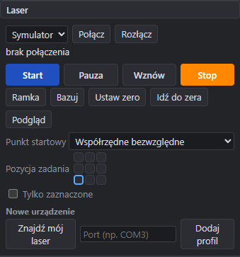 |

Wynik: **zgodne** (Start niebieski `#2050c0`, Stop pomarańczowy `#ff8800`). Przycisk „Rozpocznij od tego miejsca” w Podglądzie ma ten sam kolor co Start.

## REQ-03-053, REQ-03-054 — czas zadania po zakończeniu, licznik przejść

Procedura: uruchom zadanie z warstwą w kilku przejściach. Obok procentu okno pokazuje „przejście N/M” dla warstwy bieżącego wiersza G-code (`job.status`: `pass`, `passes`). Po zakończeniu zostaje czas zadania.

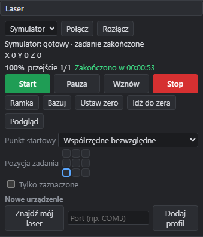

Wynik: **zgodne**. W toku: „50 % przejście 2/2 Czas 00:00:23”. Po zakończeniu: „100 % przejście 1/1 Zakończono w 00:00:53”. Ostatni przebieg to gwiazda na C01, która ma jedno przejście. Czas zostaje widoczny do następnego zadania.

## REQ-03-034, REQ-03-035, REQ-03-037, REQ-03-038, REQ-03-039 — okno Przesuń

Procedura:
- REQ-03-034, REQ-03-035: przyciski X±, Y± i Z± przesuwają głowicę (`device.jog`).
- REQ-03-037: „Krok XY (mm)” i „Krok Z (mm)” ustawiają kroki.
- REQ-03-038: „Wolno (mm/s)” i „Szybko (mm/s)” ustawiają prędkości. Przełącznik Wolno/Szybko wybiera bieżącą prędkość. Ustawienia zapisuje polecenie okna `jog.settings` w preferencjach `ui.jog`.
- REQ-03-039: wpisz nazwę i naciśnij „Zapamiętaj” (`machine.position_save`, bieżąca pozycja). Klik w pozycję przesuwa do niej głowicę (`device.position_go`), a ✕ ją usuwa. Pozycje zapisują się w `positions.json` w katalogu preferencji.

| Okno Przesuń | Po „Narożnik płyty (10, 10)” |
|---|---|
| 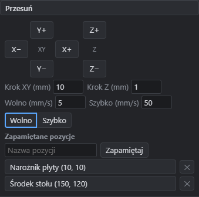 | 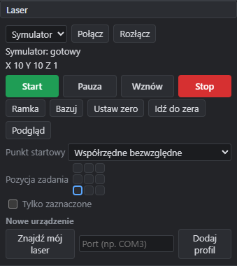 |

Wynik: **zgodne**. Po jogu X+ i Y+ (krok 10 mm) zapamiętano „Narożnik płyty (10, 10)”, potem przejazd do (150, 120) i „Środek stołu (150, 120)”. Z+ w trybie wolnym podniósł Z do 1 mm. Klik „Narożnik płyty” wrócił głowicą do X 10, Y 10.

## REQ-03-040 — okno Konsola z kolorowaniem składni i historią

Procedura: wpisz polecenia w polu Konsoli i zatwierdź Enterem (`device.raw`). Kolorowanie:
- wysłane wiersze: ›;
- słowa G: niebieskie;
- słowa M: fioletowe;
- osie i parametry: pomarańczowe;
- komentarze: kursywa;
- `ok`: zielone;
- `error:N`: czerwone;
- `ALARM`: pomarańczowe;
- komunikaty `[…]`: szare;
- ustawienia `$`: turkusowe.

Strzałki ↑/↓ przewijają historię. Historia zapisuje się w preferencjach (`ui.console_history`), więc przetrwa ponowne uruchomienie.

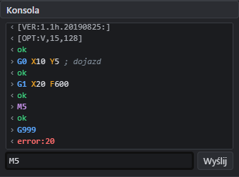

Wynik: **zgodne**. Na zrzucie widać odpowiedź `$I`, wiersz „G0 X10 Y5 ; dojazd” z komentarzem, „G1 X20 F600”, „M5” i „G999” z odpowiedzią „error:20”. Po dwóch naciśnięciach ↑ pole pokazuje przedostatnie polecenie („M5”).

## REQ-03-041 — okno Makra

Procedura: wpisz nazwę i kroki (jeden w wierszu: polecenie sterownika albo `@id.polecenia {json}`) i naciśnij „Zapisz makro” (`macro.save`). Klik w nazwę uruchamia makro (`macro.run`), a ✕ je usuwa (`macro.delete`).

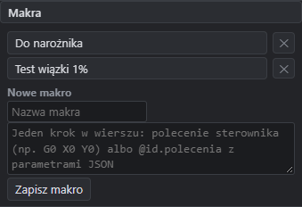

Wynik: **zgodne**. Uwaga z przeglądu (poprawione): przy szybkim zapisie dwóch makr drugie się nie zapisywało. Przebudowa okna po zapisie pierwszego podmieniała pola z wpisanym tekstem. Pola nazwy i kroków (i nazwy pozycji w oknie Przesuń) są teraz trwałe i czyszczą się dopiero po udanym zapisie.

## REQ-03-046 — okno Podgląd (z REQ-09-001…006, REQ-09-013, REQ-07-030)

Procedura: naciśnij „Podgląd”. Okno pokazuje tor głowicy z `plan.preview`:
- cięcia w kolorach warstw, a przy włączonym „Kerf” także w szerokości cięcia 2 × kerf (półprzezroczyste), na tle przerywanej linii projektu;
- przejazdy linią przerywaną;
- strzałki kierunku wzdłuż konturów;
- zielone punkty startowe;
- numery kolejności (kilka przejść z jednego punktu: „1, 3”);
- głowicę (czerwony krzyż) w bieżącym czasie.

Suwak wybiera czas. ▶ odtwarza z prędkością ×1…×500. Przełączniki pokazują i ukrywają przejazdy, kolejność, kerf, kierunek i punkty startowe. „Rozpocznij od tego miejsca” uruchamia zadanie od segmentu pod suwakiem (`job.start {from_segment}`). Sterowanie to polecenia okna `preview.open`, `preview.set` i `preview.close`.

| Całe zadanie | Połowa czasu | Bez przejazdów, kerfu i kierunku |
|---|---|---|
| 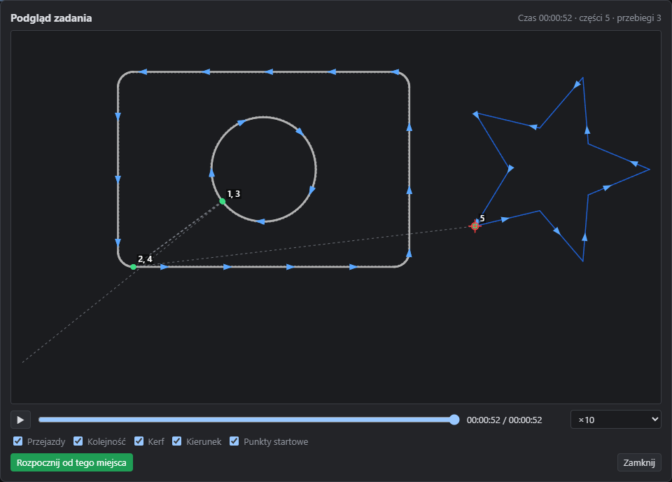 | 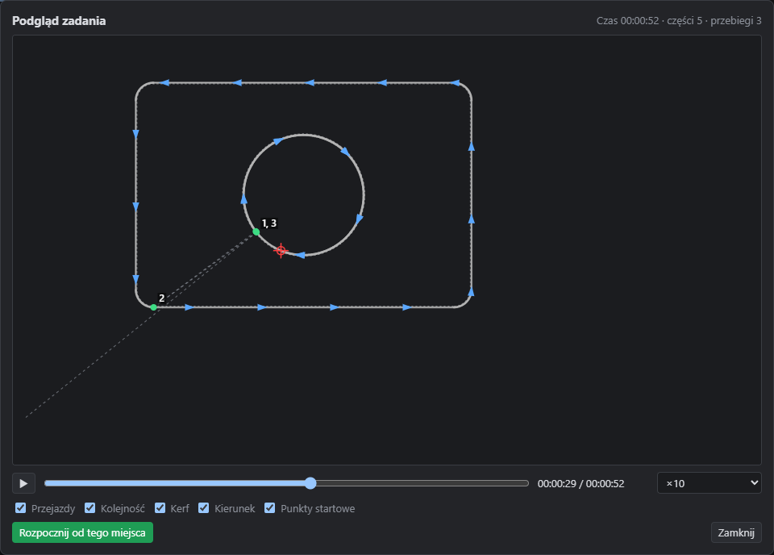 | 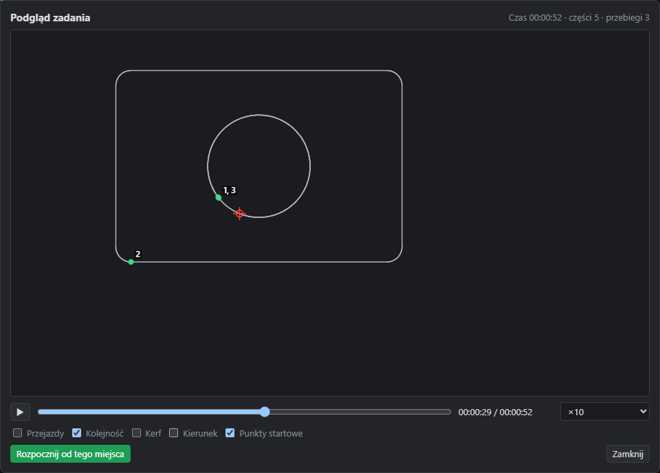 |

Wynik: **zgodne**. Kolejność: otwór przed konturem zewnętrznym (1, 2), drugie przejście (3, 4), potem gwiazda (5). Przy połowie czasu tor kończy się na głowicy w otworze.

Uwagi z przeglądu (poprawione):
- Czarna warstwa C00 była na ciemnym tle niewidoczna. Podgląd rozjaśnia ją teraz tak jak kanwa edytora.
- Numery dwóch przejść z jednego punktu nakładały się. Są teraz łączone w jeden napis.
- Strzałka kierunku była tylko na pierwszym odcinku części (na okręgu niewidoczna). Strzałki są teraz rozłożone wzdłuż konturu.
- Kerf był rysowany jako obrys pokrywający się z linią cięcia. Teraz widać szerokość cięcia względem linii projektu.

## REQ-03-004 — położenie głowicy na obszarze roboczym (z REQ-07-029, REQ-04-089)

Procedura: połącz urządzenie i przesuń głowicę (jog albo `device.move_to`). Czerwony krzyż z okręgiem pokazuje położenie głowicy w układzie dokumentu (`machine.status`: `head`, wg ustawień startu). Przy starcie od bieżącej pozycji położenie w obszarze jest nieokreślone i znacznika nie ma. Po rozłączeniu znacznik znika.

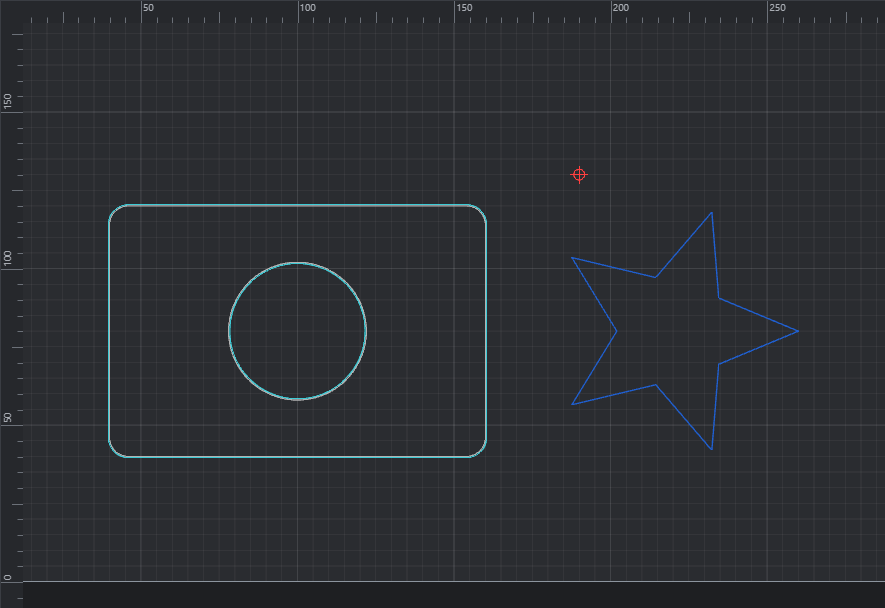

REQ-07-029: obrysy kerfu (turkusowe, `plan.kerf`) pokazują linię środka wiązki. Kontur zewnętrzny jest odsunięty na zewnątrz, otwór do wewnątrz.

| Kontur zewnętrzny (narożnik) | Otwór |
|---|---|
| 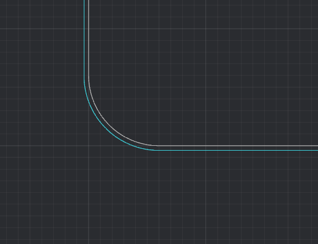 | 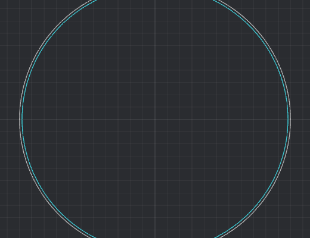 |

REQ-04-089: przycisk „⌖ Laser” na pasku Wyrównanie (`object.align_to_laser`) przesuwa zaznaczenie tak, że środek jego ramki trafia w położenie lasera.

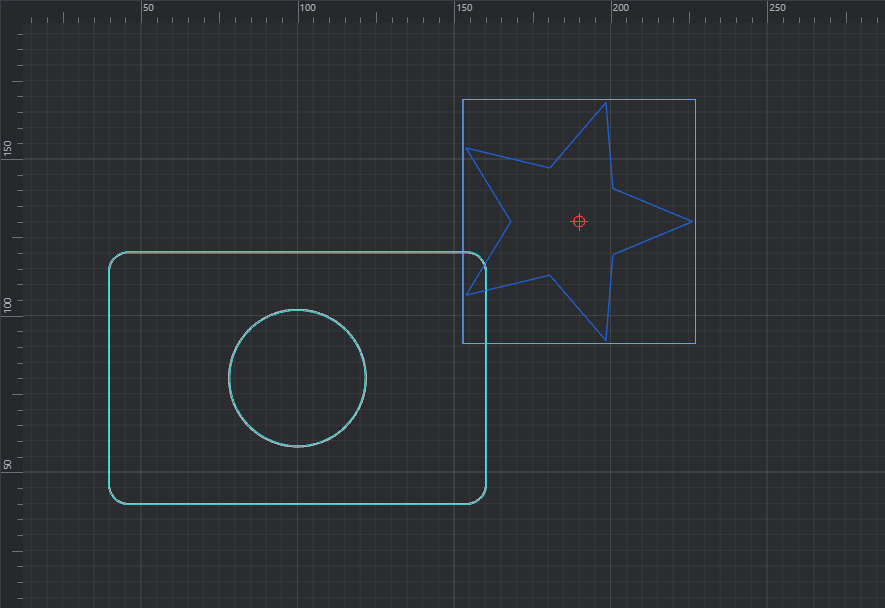

Wynik: **zgodne**. Głowica w (190, 130) jest na właściwym miejscu podziałki. Po wyrównaniu środek gwiazdy jest pod znacznikiem głowicy.

## REQ-03-032 — okno ustawień warstwy (Warstwy/Cięcia)

Dodane 2026-11-07 na zgłoszenie zleceniodawcy: w M1 panel Warstwy pozwalał ustawić tylko tryb, prędkość, moc, przejścia, wyjście i widoczność. Pozostałe parametry z §7.2 były dostępne tylko przez polecenie `layer.params` (CLI, MCP).

Procedura:
- Dwuklik na wierszu warstwy w panelu Warstwy (poza polami edycji) otwiera okno ustawień warstwy (polecenie okna `layer.settings_open {index, tab}`). Zamyka je „Zamknij” albo Escape (`layer.settings_close`).
- Zakładka **Ogólne**: nazwa, kolor, tryb, wyjście, pokaż, nadmuch (`layer.set`), prędkość, moc maks./min., przejścia (`layer.set`), opóźnienie między przejściami, priorytet, pauza z komunikatem (`layer.params`).
- Zakładka **Cięcie**: kerf (osobno X/Y), mostki automatyczne, lead-in i lead-out, overcut, moc w narożnikach, perforacja, tryb punktowy, rampa mocy.
- Zakładka **Grawer/Skanowanie**: skanowanie dwukierunkowe, kąt, cross-hatch, interwał albo LPI, overscan (wyłączony, automatyczny, % prędkości), kerf wypełnienia, grupowanie kształtów, tabela scan offset.
- Zakładka **Zaawansowane**: drugi laser (moc maks./min.), częstotliwość PWM, moc dynamiczna M3/M4, Z offset i obniżenie Z, makra G-code przed i po warstwie.
- Zakładka **Pod-warstwy**: dodaj, zmień i usuń pod-warstwę. Puste pola dziedziczą wartość z warstwy.
- Każde pole zapisuje zmianę po zatwierdzeniu (Enter albo wyjście z pola) i jest poleceniem rejestru (`data-command`). Zmiany są cofalne (Ctrl+Z). Błędna wartość pokazuje komunikat w oknie, a parametr zostaje bez zmian.

| Ogólne | Cięcie |
|---|---|
| 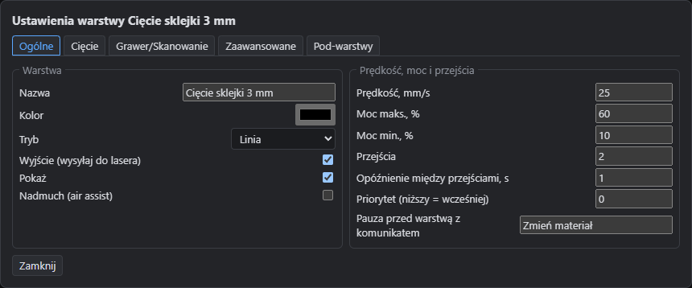 | 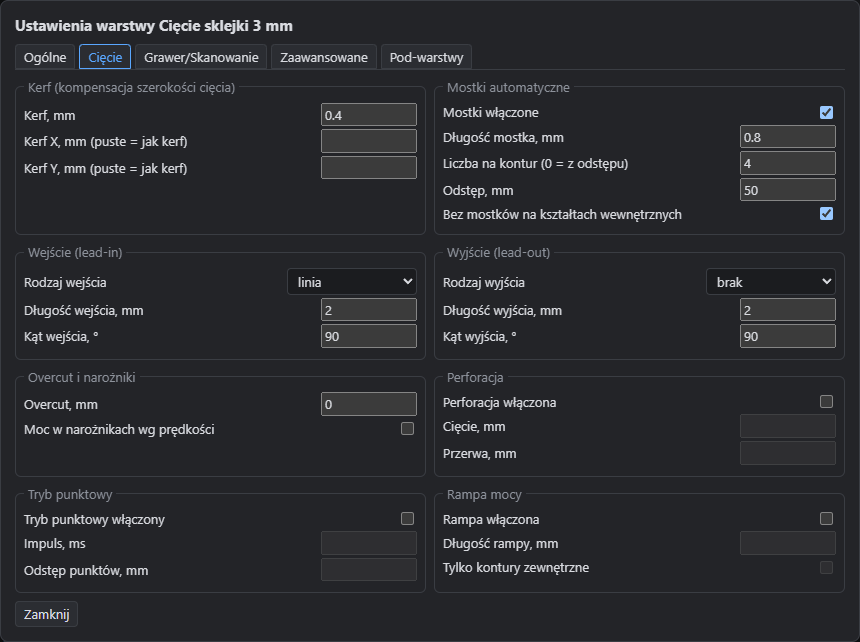 |

| Grawer/Skanowanie | Zaawansowane |
|---|---|
| 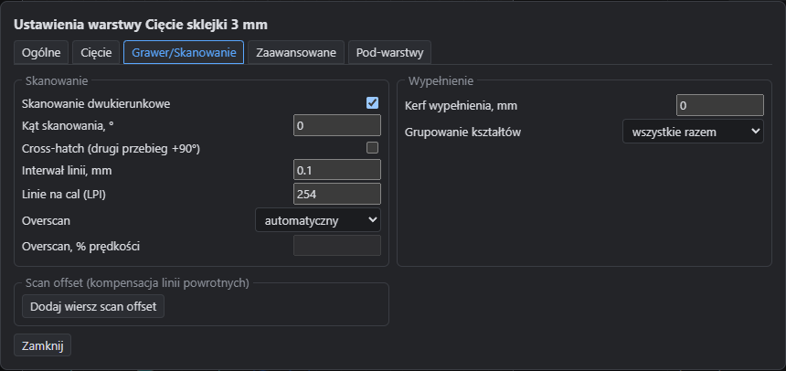 | 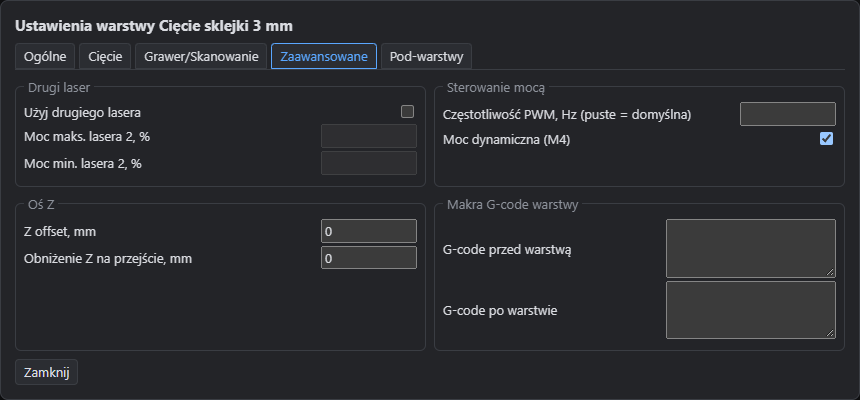 |

| Pod-warstwy | Błędna wartość (kerf 50 mm) |
|---|---|
| 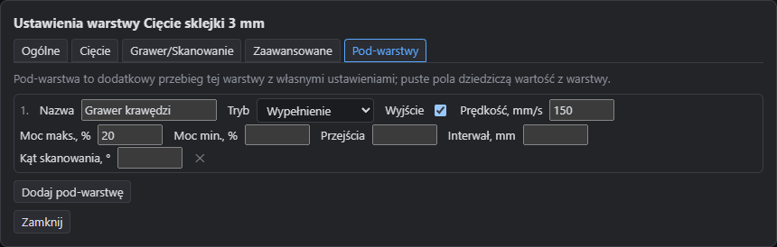 | 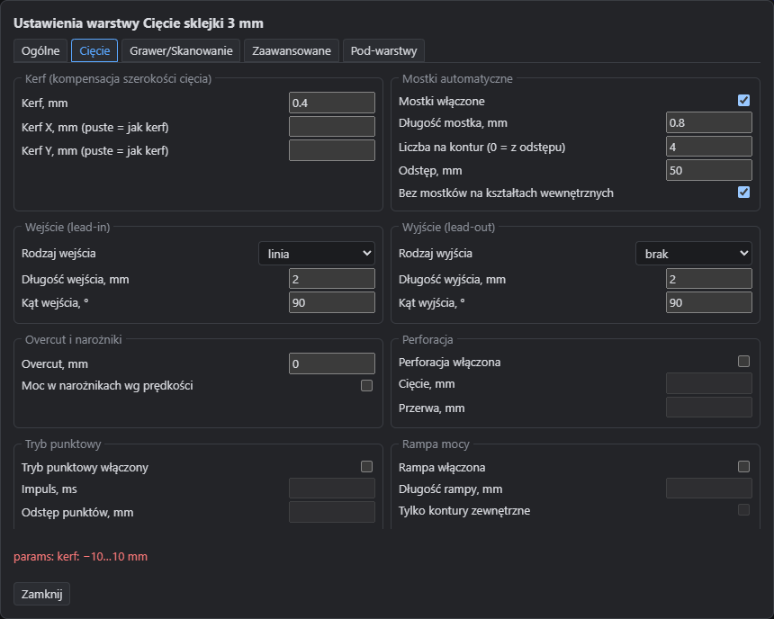 |

Wynik: **zgodne**. Okno pokazuje parametry warstwy C00 „Cięcie sklejki 3 mm” ustawione wcześniej poleceniami: 2 przejścia, opóźnienie 1 s, pauza „Zmień materiał”, kerf 0,4 mm, mostki 4 × 0,8 mm, lead-in linia 2 mm pod 90°, interwał 0,1 mm = 254 LPI, pod-warstwa „Grawer krawędzi” (Wypełnienie, 150 mm/s, 20 %). Pola wyłączonych opcji (perforacja, tryb punktowy, rampa, drugi laser, overscan %) są nieaktywne. Kerf 50 mm został odrzucony z komunikatem „kerf: −10…10 mm”.

Uwagi z przeglądu zrzutów (poprawione przed zatwierdzeniem): pola tekstowe (nazwa, komunikat pauzy, nazwa pod-warstwy) były za wąskie i ucinały tekst.
