# Procedury ręczne — etap M3

Zrzuty: `docs/procedures/img/m3/`, generator `web/e2e/procedures-m3.spec.ts` (`BC_SCREENSHOTS=1`). Urządzenia USB w zrzutach są fikcyjne (`BURNCRAFT_FAKE_USB=1`): K40 z układem CH341 bez sterownika, galvo BJJCZ ze sterownikiem WinUSB i mysz USB.

## REQ-00-018 — wiedza o protokołach wyłącznie z publicznych, otwartych źródeł

Procedura: przegląd ADR 0013, sekcji „Źródła wiedzy o protokołach” w `THIRD_PARTY.md` i komentarzy przy faktach o protokołach w kodzie (`crates/bc-drivers/src/usb.rs`).

Wynik (2026-11-07, M3.1): **zgodne**.
- ADR 0013 zapisuje zasadę zatwierdzoną przez zleceniodawcę: otwarte projekty służą tylko jako źródło wiedzy, bez kopiowania kodu, a każdy fakt ma odnośnik do źródła.
- Fakty o protokołach w M3.1 to VID/PID z §13.3 specyfikacji oraz punkty końcowe CH341 i BJJCZ z opisów otwartych projektów (oznaczone `UNVERIFIED`).
- Licencje: MeerK40t — MIT (sprawdzona). Pozostałe źródła mają adnotację „do sprawdzenia przy pierwszym użyciu”.

Procedurę trzeba powtórzyć przy M3.2 (Ruida) i M3.3 (Lihuiyu, Moshi), kiedy przybędzie źródeł.

Powtórzenie (2026-11-08, M3.3): **zgodne**.
- Przegląd ADR 0014, tabeli w `THIRD_PARTY.md` i komentarzy w `crates/bc-drivers/src/{ch341.rs,lihuiyu/,moshi/}`.
- Fakty o EGV, Moshi i CH341 pochodzą z MeerK40t (MIT): README modułów `lihuiyu` i `moshi` oraz opis zachowania `laserspeed.py`, `parser.py`, `controller.py`, `driver.py`, `builder.py`, `ch341/libusb.py`, `windriver.py`. Kod napisano od zera. Tablica kodów Moshi i CRC-8 są liczone z reguł, nie kopiowane.
- Funkcje CH341DLL pochodzą z dokumentacji producenta (nagłówek CH341DLL.H), a MD5 i CRC-8 — z dokumentów publicznych (RFC 1321, katalog CRC).
- K40 Whisperer (GPL-3.0) nie był używany.
- Szczegóły niepotwierdzone na sprzęcie mają `UNVERIFIED` i trafiają do checklisty testu K40 (M3.4), spisanej w ADR 0014.

## REQ-13-020 — kreator instalacji sterownika USB na Windows

Procedura: okno Laser → „Znajdź mój laser” (`machine.find`). W sekcji „Urządzenia USB” są lasery znanych rodzin ze stanem dostępu. Przy urządzeniu bez sterownika WinUSB przycisk „Jak podłączyć…” (`machine.usb_guide`) otwiera przewodnik w oknie dialogowym.

| Lista urządzeń USB | Przewodnik (pl) | Przewodnik (en) |
|---|---|---|
| 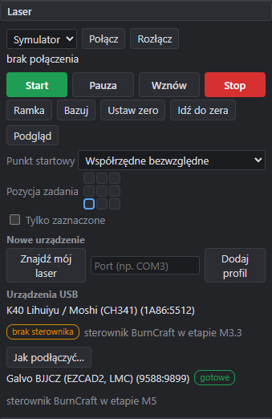 | 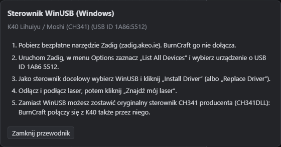 | 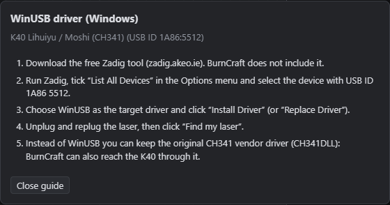 |

Wynik (2026-11-07): **zgodne**.
- K40 (CH341, `1A86:5512`) ma stan „brak sterownika” i przycisk przewodnika.
- Galvo BJJCZ ma stan „gotowe” i nie ma przewodnika; mysz USB nie jest pokazana.
- Przewodnik prowadzi przez instalację WinUSB narzędziem Zadig, którego BurnCraft nie dołącza (decyzja zleceniodawcy). Podaje USB ID do wyboru w narzędziu i alternatywę: oryginalny sterownik CH341 producenta (REQ-13-040, M3.3).
- Tłumaczenie angielskie jest kompletne.
- Stan „sterownik BurnCraft w etapie M3.3/M5” informuje, że sam sterownik lasera powstaje później.
- Aktualizacja M3.3 (2026-11-08): sterownik K40 już jest, więc przy K40 nie ma dopisku o etapie. Są za to przyciski „Dodaj K40 (Lihuiyu)” i „Dodaj Moshi” (`machine.profile_save`); zrzut `usb-found.png` jest odświeżony.

Uwagi z przeglądu zrzutów (poprawione przed zatwierdzeniem): w pierwszej wersji przewodnik był w panelu bocznym i jego dolna część była ucięta. Teraz otwiera się w oknie dialogowym.

Do sprawdzenia na sprzęcie (test K40, M3.4): stan „brak sterownika” na prawdziwym urządzeniu i połączenie po instalacji WinUSB.

## REQ-13-021 — reguły udev na Linuksie

Procedura:
- Plik `packaging/linux/99-burncraft.rules` daje dostęp zalogowanemu użytkownikowi (`TAG+="uaccess"`, `MODE="0660"`) do urządzeń znanych rodzin. Generuje go `usb::udev_rules()`, a test sprawdza, że plik w repozytorium jest aktualny.
- `burncraft-cli udev` wypisuje reguły. Instalacja:

```
burncraft-cli udev | sudo tee /etc/udev/rules.d/99-burncraft.rules
sudo udevadm control --reload-rules && sudo udevadm trigger
```

- Przewodnik w GUI przy stanie „brak uprawnień” pokazuje te same kroki (tłumaczenia `usb-guide-udev-*`).
- CI na Linuksie sprawdza składnię pliku poleceniem `udevadm verify`.

Wynik (2026-11-07): **zgodne**. Treść reguł sprawdzają test `req_13_021_udev_rules_file_matches_known_families` i test CLI `req_13_021_cli_prints_udev_rules`, a składnię — CI. Nadanie uprawnień prawdziwemu urządzeniu na Linuksie nie było sprawdzane: zleceniodawca testuje K40 na Windows.

## REQ-13-045 — brak PWM: pole mocy nieaktywne, komunikat, dither i prędkość

Procedura: okno Laser → wybór urządzenia „Symulator K40 (Lihuiyu)” (płyta M2 Nano bez PWM) → „Połącz” (`machine.connect`). Następnie przegląd:
- panelu Warstwy z prostokątem na warstwie C00;
- okna ustawień warstwy (`layer.settings_open`), zakładka Ogólne;
- sekcji „Płyta K40” w oknie Laser.

Dla porównania to samo z urządzeniem „Symulator” (GRBL z PWM).

| Warstwy (pl) | Warstwy (en) | Urządzenie z PWM (GRBL) |
|---|---|---|
| 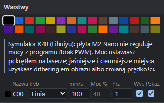 | 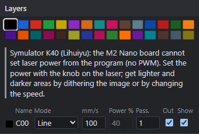 | 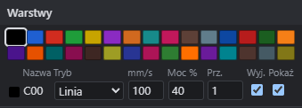 |

| Ustawienia warstwy (pl) | Ustawienia warstwy (en) |
|---|---|
| 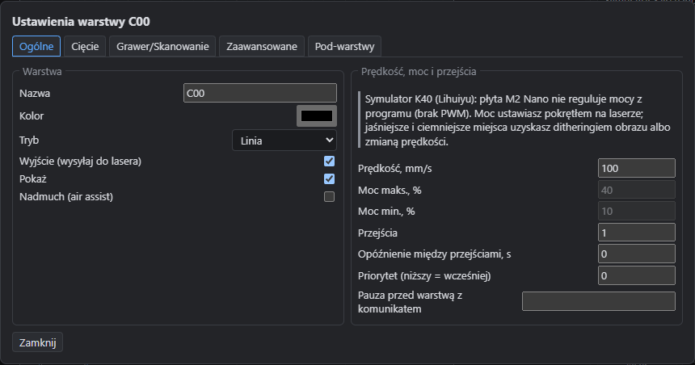 | 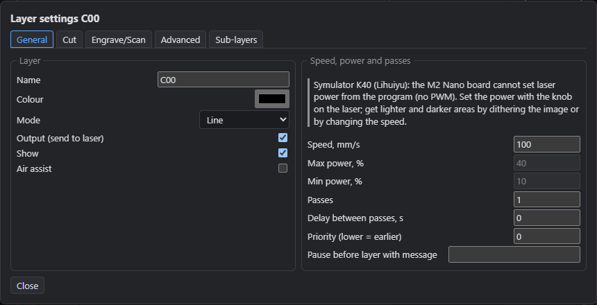 |

| Płyta K40 w oknie Laser (pl) | (en) |
|---|---|
| 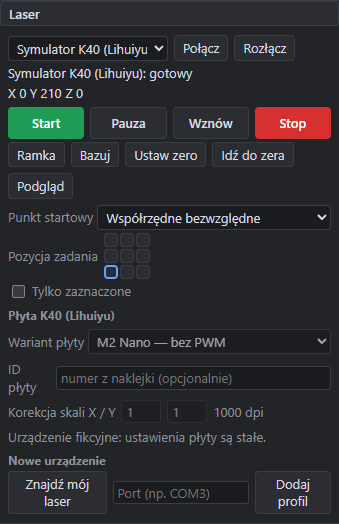 | 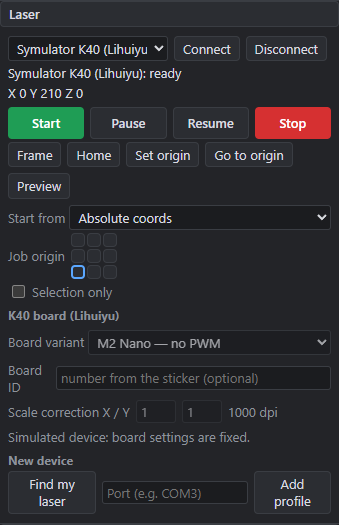 |

Wynik (2026-11-08): **zgodne**.
- Z urządzeniem bez PWM pole „Moc %” w panelu Warstwy jest nieaktywne (przyciemnione, obramowanie przerywane) i ma podpowiedź „Brak PWM: moc ustawia pokrętło na laserze”.
- Nad tabelą jest komunikat z nazwą urządzenia i płyty: moc ustawia się pokrętłem na laserze, a jaśniejsze i ciemniejsze miejsca uzyskuje się ditheringiem obrazu albo prędkością.
- W oknie ustawień warstwy pola „Moc maks.” i „Moc min.” są nieaktywne, a nad nimi jest ten sam komunikat. Prędkość pozostaje edytowalna.
- Urządzenie z PWM (GRBL) ma aktywne pole mocy i nie ma komunikatu. Tłumaczenie angielskie jest kompletne.
- Sekcja „Płyta K40” pokazuje wariant „M2 Nano — bez PWM”. Lista wariantów oznacza płyty bez PWM; PWM ma tylko M3 Nano i 6C6879-LASER-M3.
- Zachowanie kompilatora sprawdzają testy automatyczne:
  - moc < 100 % daje ostrzeżenie `power_ignored`, a wiązka jest włączona na pełną moc pokrętła;
  - zmienna moc w grafice jest zamieniana na dither (`req_13_045_no_pwm_power_ignored_warning`);
  - zachowanie GUI: test E2E `req_13_045_no_pwm_power_field_disabled_with_message`.

Do sprawdzenia na sprzęcie (test K40, M3.4): nie dotyczy GUI. Faktyczna moc z pokrętła i wygląd ditheru na materiale należą do checklisty K40.

## REQ-03-042 — okno „Lista plików na sterowniku”

Procedura: profil urządzenia „FluidNC (emulator)” (sterownik GRBL, transport emulator, odmiana `fluidnc` z kartą SD i XMODEM) i prostokąt 40 × 25 mm na C00. Kroki:
- okno Laser → „Połącz” (`machine.connect`), potem „Pliki na sterowniku” (`files.open`);
- „Wyślij projekt” z nazwą `/sd/prostokat.gcode` (`device.sd_upload`, G-code skompilowany dla urządzenia);
- „Wyślij plik z dysku…” z plikiem `test-ramki.gcode` (`device.sd_upload {text}`; plik trafia do katalogu z pola nazwy);
- „Usuń” przy drugim pliku (`device.sd_delete` po potwierdzeniu), potem „Nie”;
- to samo po angielsku; na koniec okno z urządzeniem „Symulator K40 (Lihuiyu)”.

| Pusta karta (pl) | Lista plików (pl) | Potwierdzenie usunięcia (pl) |
|---|---|---|
| 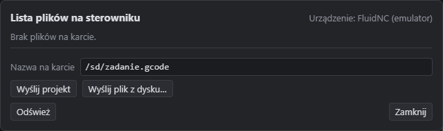 | 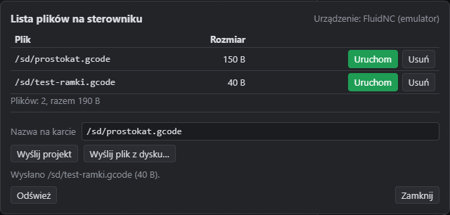 | 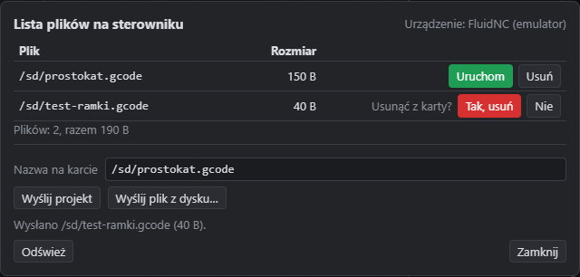 |

| Empty card (en) | File list (en) | Delete confirmation (en) |
|---|---|---|
| 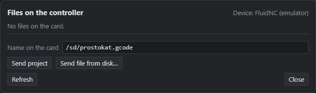 | 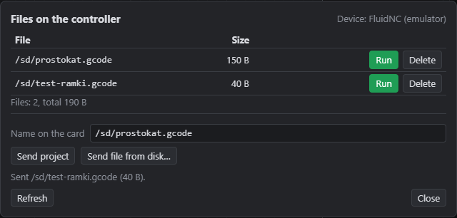 | 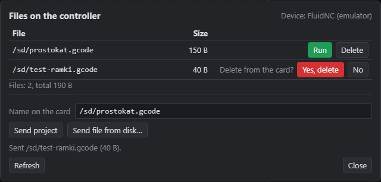 |

| Przycisk w oknie Laser | K40: brak pamięci plików |
|---|---|
| 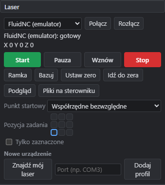 | 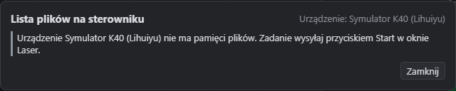 |

Wynik (2026-11-08): **zgodne**.
- Okno pokazuje urządzenie, listę plików z rozmiarem (B, kB, MB; przecinek dziesiętny po polsku) i sumę („Plików: 2, razem 190 B”).
- Każdy wiersz ma „Uruchom” (`device.sd_run`, wyróżniony kolorem Start) i „Usuń”. Usunięcie wymaga potwierdzenia w wierszu („Usunąć z karty?” — „Tak, usuń” w kolorze Stop, „Nie”). Szerokość kolumn nie zmienia się przy potwierdzeniu.
- Pod listą jest pole „Nazwa na karcie” (domyślnie `/sd/zadanie.gcode`) i przyciski „Wyślij projekt” oraz „Wyślij plik z dysku…”. Wiersz stanu potwierdza wysłanie z nazwą i rozmiarem; błąd sterownika pojawia się w oknie na czerwono.
- Przy urządzeniu bez pamięci plików (K40, Moshi, GRBL bez karty) okno pokazuje komunikat z nazwą urządzenia i wskazówką, że zadanie wysyła się przyciskiem Start. Nie ma listy ani przycisków wysyłki.
- Każda kontrolka okna ma `data-command` (sprawdza test E2E `req_03_042_driver_files_window_list_upload_run_delete`). Esc i „Zamknij” zamykają okno (`files.close`). Tłumaczenie angielskie jest kompletne.

Uwagi z przeglądu zrzutów (poprawione przed zatwierdzeniem): w pierwszej wersji kolumna akcji zmieniała szerokość przy potwierdzeniu usunięcia, a linia pod wierszem kończyła się przed przyciskami (komórka z `display: flex`).

Do sprawdzenia na sprzęcie: format odpowiedzi `$SD/List` i polecenie `$Xmodem/Receive` prawdziwego FluidNC (`UNVERIFIED`). W teście K40 okno sprawdza tylko komunikat o braku pamięci plików (checklista K40, punkt A17); sterownika FluidNC z kartą SD nie testowano na sprzęcie.
